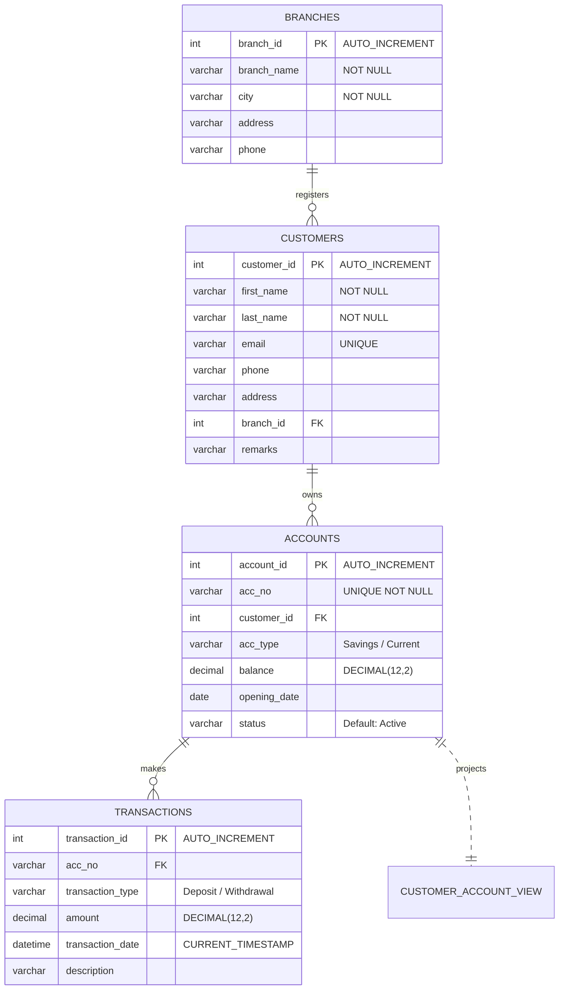

<div align="center">

<!-- Animated Typing SVG Header -->
<a href="https://github.com/">
  
</a>

<p align="center">
  
  
  
  
  
</p>

<p align="center">
  <b>A production-inspired relational banking ledger built in MySQL 8.0 featuring automated balance synchronization, overdraft guard triggers, atomic fund transfers, reporting views, and B-Tree indexing.</b>
</p>


</div>

---

## 🎯 Purpose of the Project

Modern banking systems cannot rely solely on application-layer checks to protect financial accuracy. **`embedded_bank_db`** pushes critical business rules, concurrency locks, and ledger automation directly into the database engine:

- 🛡️ **Zero Overdrafts & Negative Entries:** `BEFORE INSERT` triggers intercept invalid amounts and insufficient funds before a row ever touches the ledger.
- ⚡ **Zero-Touch Balance Sync:** `AFTER INSERT` triggers automatically credit or debit account balances whenever a transaction is logged.
- 🔒 **Atomic Fund Transfers:** Stored procedures wrap multi-step transfers inside `START TRANSACTION` blocks with `FOR UPDATE` row locks and automatic `ROLLBACK` handlers.
- 📊 **Instant Reporting:** Pre-joined SQL `VIEW`s and `B-Tree` indexes simplify auditing and accelerate customer lookups.

---

## 🗺️ Entity-Relationship (ER) Architecture



> 💡 *Tip: Place your `Embedded_bank.png` ER diagram inside an `assets/` folder and embed it via ``.*

---

## 🧩 What Is Inside (`embedded_bank_db`)

| Category | Database Objects | Purpose & Role |
| :--- | :--- | :--- |
| **Core Tables (4)** | `branches`, `customers`, `accounts`, `transactions` | Normalized 3NF banking schema with `PK`, `FK`, `UNIQUE`, and `DECIMAL(12,2)` constraints. |
| **Triggers (3)** | `check_transaction_amount`, `check_withdrawal_balance`, `update_account_balance` | Enforces positive amounts, blocks overdrafts, and auto-updates account balances. |
| **Procedures (2)** | `transfer_funds()`, `get_customer_accounts()` | Executes ACID-safe peer-to-peer transfers and retrieves customer portfolios. |
| **Function (1)** | `get_customer_balance()` | Computes aggregated customer wealth inline inside `SELECT` queries. |
| **Views (2)** | `customer_account_view`, `transaction_history_view` | Abstracts multi-table `INNER JOIN`s into clean, audit-ready virtual tables. |
| **Indexes (3)** | `idx_customer_email`, `idx_account_balance`, `idx_transaction_date` | B-Tree indexes accelerating customer lookups, balance filtering, and date sorting. |

---

## ⚙️ How It Works & Why It's Used (Key SQL Snippets)

### 1️⃣ Automated Guard & Sync Triggers
* **How it works:** Fires automatically on every `INSERT` into `transactions`. First, `BEFORE INSERT` triggers validate `amount > 0` and verify sufficient funds via `SIGNAL SQLSTATE '45000'`. Next, the `AFTER INSERT` trigger adjusts `accounts.balance`.
* **Why it's used:** Eliminates balance drift and guarantees no withdrawal can exceed available funds—even if an external app forgets to validate.

```sql
-- Guard Trigger: Reject overdrafts before insertion
CREATE TRIGGER check_withdrawal_balance
BEFORE INSERT ON transactions
FOR EACH ROW
BEGIN
    IF NEW.transaction_type = 'Withdrawal' THEN
        IF NEW.amount > (
            SELECT balance FROM accounts WHERE acc_no = NEW.acc_no
        ) THEN
            SIGNAL SQLSTATE '45000'
            SET MESSAGE_TEXT = 'Insufficient balance! Withdrawal rejected';
        END IF;
    END IF;
END;

-- Sync Trigger: Automatically adjust account balance
CREATE TRIGGER update_account_balance
AFTER INSERT ON transactions
FOR EACH ROW
BEGIN
    IF NEW.transaction_type = 'Deposit' THEN
        UPDATE accounts SET balance = balance + NEW.amount WHERE acc_no = NEW.acc_no;
    ELSEIF NEW.transaction_type = 'Withdrawal' THEN
        UPDATE accounts SET balance = balance - NEW.amount WHERE acc_no = NEW.acc_no;
    END IF;
END;
```

---

### 2️⃣ ACID Fund Transfers (`transfer_funds`)
* **How it works:** Uses `START TRANSACTION`, locks the sender's row with `SELECT ... FOR UPDATE` to prevent race conditions, logs paired `Withdrawal` and `Deposit` records, and rolls back automatically on any `SQLEXCEPTION`.
* **Why it's used:** Guarantees **Atomicity** and **Isolation**—money is never deducted from a sender without being credited to the receiver.

```sql
CALL transfer_funds('1000000000', '1000000001', 500.00);
```

---

### 3️⃣ Virtual Reporting Views & Stored Functions
* **How it works:** Joins `customers`, `accounts`, and `transactions` behind reusable views while `get_customer_balance()` calculates total holdings per customer using `COALESCE(SUM(balance), 0)`.
* **Why it's used:** Simplifies complex multi-table queries into single-line statements for dashboards and audit statements.

```sql
-- Query unified customer & account profile
SELECT * FROM customer_account_view WHERE balance > 40000;

-- Compute total customer holdings inline
SELECT first_name, last_name, get_customer_balance(customer_id) AS total_balance
FROM customers;
```

---

## 📊 Live Database Metrics Snapshot

```text
+-------------------+------------------+--------------------+-----------------+-------------------+
| Active Branches   | Total Customers  | Total Bank Balance | Total Deposits  | Total Withdrawals |
+-------------------+------------------+--------------------+-----------------+-------------------+
| 5 Branches        | 9 Customers      | ₹ 396,000.00       | ₹ 97,500.00     | ₹ 34,500.00       |
+-------------------+------------------+--------------------+-----------------+-------------------+
```

---

## 🚀 Quick Start

1. **Launch MySQL Shell or CLI:**
   ```bash
   mysql -u root -p
   ```
2. **Import the SQL Script:**
   ```sql
   SOURCE Ranit Das_Embedded_bank.sql;
   ```
3. **Verify Objects & Test Triggers:**
   ```sql
   USE embedded_bank_db;
   SHOW TABLES;
   SHOW TRIGGERS;
   SELECT * FROM transaction_history_view ORDER BY transaction_date DESC LIMIT 5;
   ```

---

<div align="center">


**Built with ❤️ using MySQL 8.0 • Designed for Financial Data Integrity**

</div>